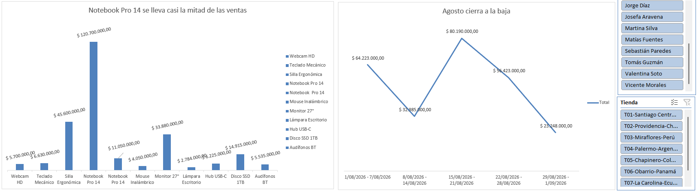

# Análisis de ventas por tienda y producto (Excel + Power Query)

## Problema
Analizar las ventas de agosto de 7 tiendas en 6 países para saber qué
tiendas, productos y categorías generan más ventas y más margen.

## Qué hice
- Limpié los datos con Power Query (fechas en formatos mixtos, nombres de
  vendedores y productos con errores de escritura).
- Calculé costo y margen por pedido.
- Armé tablas dinámicas y un dashboard con segmentadores.

## Hallazgos
- Chile concentra ~46% de las ventas; Santiago Centro solo, ~33%.
- Computación es ~51% de las ventas pero tiene el margen más bajo (~25%).
  Audio y Accesorios rinden ~45% de margen con poco volumen.
- La semana del 15 al 21 de agosto fue la mejor; la del 8 al 14, la más débil.

## Supuestos y limitaciones
- Dataset del curso IPS DATAX; la limpieza, el modelo y el análisis son míos.
- Los valores están sumados sin conversión de moneda entre países.
- Se mantuvieron 6 filas idénticas porque tienen ID de pedido distinto.
- La última semana está incompleta (29/08 – 1/09).

## Herramientas
Excel, Power Query, tablas dinámicas, segmentadores.
